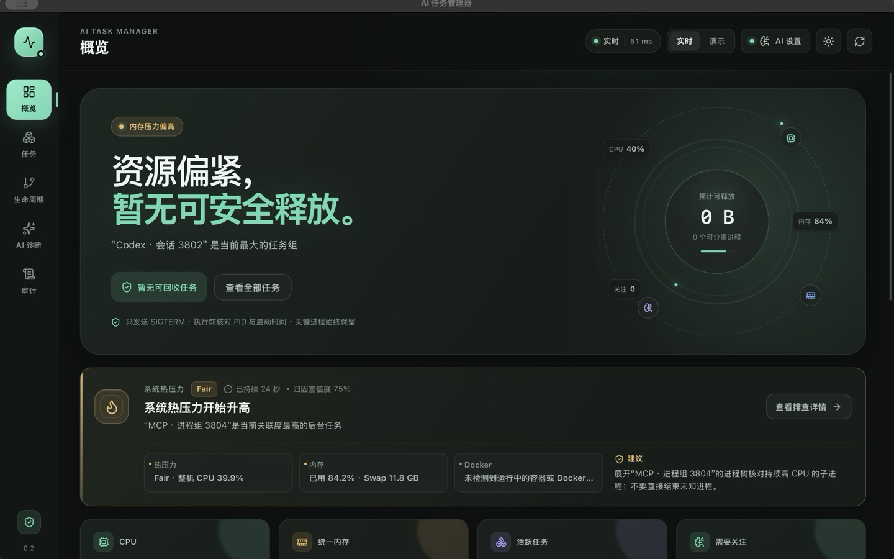
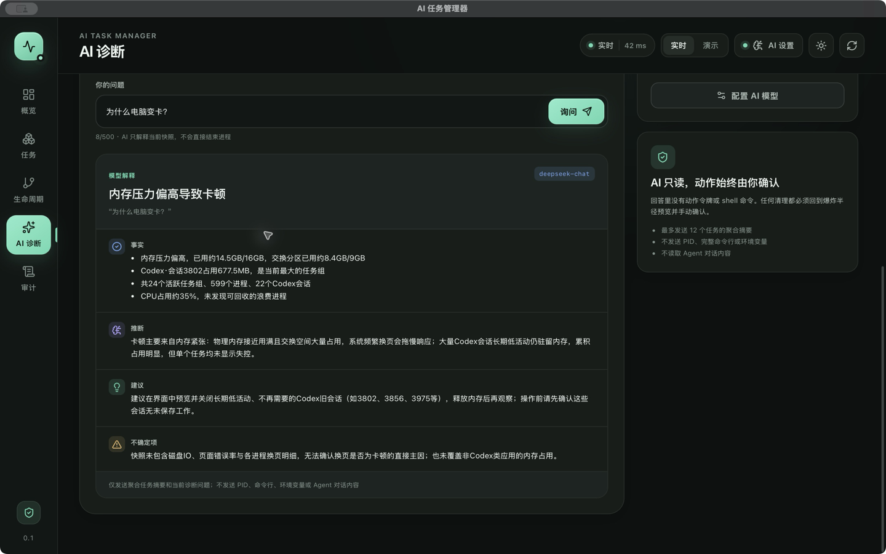
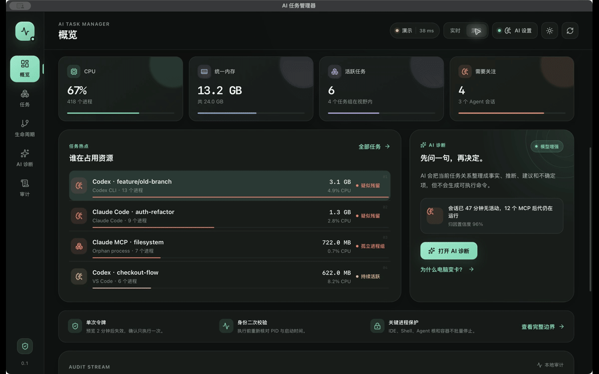
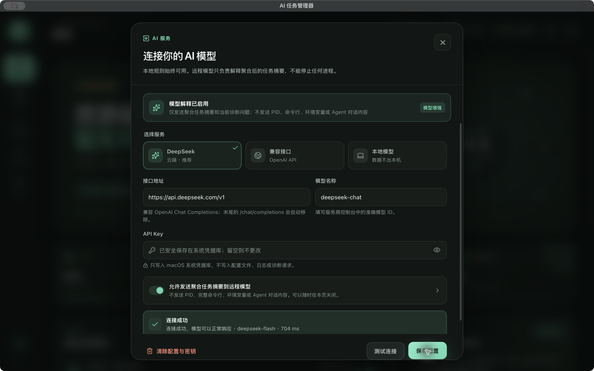

# AI 任务管理器

> 看清每一个正在消耗电脑的任务。

**状态：macOS arm64 MVP 已完成开发验收 · v0.2.0 · Apache-2.0**



AI 任务管理器是一款面向 AI 原生开发者的本地工作负载监控与安全回收工具。它把散落在进程树、IDE、终端、Docker 容器和 AI Agent 会话中的资源消耗，重新组织成用户能理解的“任务”，并给出有证据、可预览的安全清理建议。

它不只回答“哪个 PID 在吃 CPU”，还回答一个更实际的问题：

> **电脑为什么变热或变卡？哪个任务在占用资源，哪些后代进程其实已经没人用了，清理会影响谁？**

## 为什么需要它

现有工具通常只覆盖系统的一部分：

- 活动监视器、任务管理器、btop、Glances 展示扁平进程和基础资源；
- Docker Desktop、OrbStack、Portainer 只看容器；
- Langfuse、Opik 等工具只看 LLM 调用链；
- PM2、systemd、overmind 只能管理事先注册的进程；
- Agent harness 会启动 shell、MCP server、sub-agent、浏览器和容器，但会话结束后，后代进程常常仍然存活。

结果是用户能看到几百个 PID，却无法快速判断“它们属于哪个任务、是否还应该存在、能不能安全收掉”。AI 任务管理器用**任务归因 + 生命周期证据 + 爆炸半径预览**补上这一层。

## 已实现

- **实时系统概览**：CPU、内存、Swap、进程数、任务 RSS、Agent 会话和 Docker 容器数。
- **系统热压力巡检**：使用 macOS 公开 `thermalState` 读取 Nominal / Fair / Serious / Critical，持续高压时自动关联后台任务、展示证据并发送一次系统通知；不猜测摄氏度，也不会自动结束进程。
- **任务优先归因**：把进程树、Codex/Claude Code 会话、MCP 后代、开发服务器和 Docker 容器组织为任务。
- **任务热力树**：面积表示 RSS，同色相明度表示 CPU，风险同时使用图标、文字和纹理表达。
- **生命周期河流**：展示任务已存活时间、后代节点和疑似残留事件。
- **证据驱动诊断**：展示重复 MCP、高内存、持续高 CPU、父进程退出、归因置信度等事实。
- **爆炸半径预览**：操作前列出将停止的 PID、受保护进程、预计释放内存和动作限制。
- **安全回收**：短时单次令牌、PID + 启动时间二次校验、保护规则、SIGTERM、逐 PID 回执和本地审计流。
- **本地 AI 诊断**：没有模型也能回答 CPU、内存、Agent、MCP、端口和长时间任务问题。
- **可选模型解释**：支持 DeepSeek 与 OpenAI-compatible provider；已用 `deepseek-chat` 完成真实问答验收，调用失败时自动回退本地规则。
- **确定性演示模式**：内置合成 Agent 残留场景，可复现发现、归因、预览和回收全流程。
- **视觉与可访问性**：暗色/亮色主题、1024×720 响应式布局、键盘可操作图表、文本降级和 `prefers-reduced-motion` 支持。



### 12.66 秒端到端演示



> 演示来自确定性 fixture，展示概览 → 任务 → 生命周期 → AI 诊断 → 爆炸半径预览 → AI 设置；录制过程不连接真实进程，也不执行回收。

## 开源亮点

这个项目不是“更漂亮的通用监控面板”，真正的差异是四层能力组合：

1. **任务归因层**：将 PID/PPID 结构转换成用户能理解的工作负载，并保留每个结论的证据和置信度。
2. **生命周期叙事**：任务热力树回答“资源集中在哪”，生命周期河流回答“为什么还在运行”，爆炸半径预览回答“清理会影响谁”。
3. **可信操作模型**：模型只读，动作由确定性策略层生成；先预览、再确认、逐 PID 校验，不做黑盒“一键优化”。
4. **可复现的视觉演示**：确定性 fixture 让截图、录制和交互测试不依赖用户本机安装了哪些 Agent。

设计语言为 **Signal Deck**：石墨黑与瓷白、薄荷青、资源蓝；不使用粉色，红/橙只用于风险和阻断。动效用于解释状态变化和操作结果，持续装饰动画只出现在品牌和加载状态，并遵守 `prefers-reduced-motion`。

## 快速开始

### 环境要求

- macOS 13+
- [MyGo](https://github.com/egoist/mygo) `0.7.4+`（通过项目依赖安装）
- Go `1.27.3+`
- Bun `1.3+`

### 桌面开发模式

```sh
bun install --frozen-lockfile
GOTOOLCHAIN=auto bun run dev
```

桌面窗口会读取真实的 CPU、内存和进程快照。停止动作只对具备回收证据、且通过保护规则校验的后代进程生效。

### 浏览器预览

```sh
bun run dev:web
```

浏览器无法访问 MyGo Go bridge，因此只展示确定性演示快照，不读取本机进程，也不能执行真实回收。

### 构建

```sh
GOTOOLCHAIN=auto bun run build
```

macOS arm64 构建产物：

```text
build/darwin-arm64/AI 任务管理器.app
build/darwin-arm64/ai-task-manager-0.2.0-arm64.dmg
```

当前产物使用 ad-hoc 签名，尚未做 Developer ID 签名和 notarization。`codesign --verify --deep --strict` 可通过，但 Gatekeeper 的 `spctl --assess` 会拒绝，暂不适合直接作为正式公开发行包。

## 验证

```sh
GOTOOLCHAIN=auto go test ./...
GOTOOLCHAIN=auto go vet ./...
bun run typecheck
bun run test
GOTOOLCHAIN=auto bun run build
```

本次 macOS arm64 验收证据、真实桌面观察和已知限制见 [开发验收报告](docs/acceptance.md)。

## 实时模式与演示模式

- **实时模式**：通过 Go 采集器读取本机快照；实时数据会随系统状态变化。
- **演示模式**：使用固定合成场景 `Codex · feature/old-branch`，包含 12 个重复 MCP 后代、受保护的 Agent 根、容器和可回收容量，适合截图、开发和演示。

演示模式中的回收只更新本地演示状态，不会发送系统信号。实时模式中的动作目标会重新校验 PID 与启动时间，防止 PID 复用误伤。

## 热压力监测与通知

macOS 只通过公开 `NSProcessInfo.thermalState` 暴露热压力等级，不提供稳定、无需额外权限的精确温度读数。因此本项目坚持展示 **Nominal / Fair / Serious / Critical**，绝不把估算值包装成“CPU 温度”。

- 应用就绪后每 25 秒在后台巡检一次，使用与概览相同的任务归因结果寻找可能原因；
- `Fair` 只进入观察状态；`Serious` 连续 60 秒才提示，`Critical` 立即提示；
- 同一归因任务 15 分钟内不重复通知，不同原因仍可触发新提示；
- 通知只包含脱敏后的任务类别和“打开应用查看证据”，不包含 PID、路径、命令行或密钥；
- 点击通知会恢复并聚焦主窗口；通知权限被拒绝后不会反复弹授权；
- 热压力卡展示持续时间、归因置信度、最多三条证据和建议，并可跳到对应任务；
- 本次运行内保留最近 60 个真实热压力样本，界面展示最近 12 个，用于判断压力是否持续或正在恢复；
- 归因任务只有在现有安全规则下可回收时，才显示“查看回收预览”，仍需预览、单次令牌和用户确认。

热压力巡检是只读诊断，不会创建动作令牌、调用 shell 或自动清理任务。冷却/恢复状态至少保持 2 分钟，避免一次短暂回落就宣告问题结束。

## AI 配置与隐私

默认使用**本地规则引擎**，不联网，不要求 API key。当前本地规则可回答：

- CPU、内存占用最高的任务；
- Agent 会话分布和运行时长；
- 重复 MCP 与疑似残留；
- 指定端口归属；
- 可回收容量及其证据。

### 在应用内配置

打开右上角 **AI 设置**，选择 DeepSeek 或“兼容接口”，填写接口地址、模型名称与 API Key，并显式打开“允许发送聚合任务摘要到远程模型”。设置页提供连接测试；当前版本已用以下配置完成真实问答验收：

```text
Provider: DeepSeek
Base URL: https://api.deepseek.com/v1
Model:    deepseek-chat
```

API Key 只写入 macOS 系统钥匙串（Keychain），不写入普通配置文件、日志、截图或诊断请求。重启应用后，非敏感设置和 Keychain 中的凭据会自动恢复；清空配置时可以同时删除已保存的密钥。



### 使用环境变量

接入本地 OpenAI-compatible 端点：

```sh
export AITM_AI_BASE_URL="http://127.0.0.1:11434/v1"
export AITM_AI_MODEL="your-model"
export AITM_AI_API_KEY="optional"

GOTOOLCHAIN=auto bun run dev
```

接入远程端点时必须显式允许：

```sh
export AITM_AI_BASE_URL="https://your-provider.example/v1"
export AITM_AI_MODEL="your-model"
export AITM_AI_API_KEY="your-key"
export AITM_AI_ALLOW_REMOTE=true

GOTOOLCHAIN=auto bun run dev
```

隐私边界：

- 最多发送 12 个任务的聚合摘要、系统摘要和当前诊断问题；
- 不发送 PID、完整命令行、环境变量或 Agent 对话内容；
- 模型响应必须是结构化 JSON；校验失败时自动回退本地规则；
- 模型只读，不获得动作令牌、工具调用或 shell 权限；
- 回答中的任何清理建议都必须回到界面预览，并由用户再次确认。

> 真实 DeepSeek `deepseek-chat` 端点、结构化回答、非降级路径、Keychain 保存和重启恢复均已在最终桌面构建中完成验收；本地规则与失败降级仍由自动化测试覆盖。

## 安全模型

- 只对当前快照中标记为可回收、且有后代替换证据的任务生成预览；
- 保护 Agent 会话根、IDE、Shell、系统进程、本应用及其祖先、监听中的开发任务和 Docker 容器；
- 预览只读，不会直接创建可执行动作；用户必须在完整影响范围下显式勾选确认；
- 确认后才生成独立执行令牌，实时执行前再次校验每个目标的 PID 与启动时间；
- 预览与执行令牌均在 2 分钟后过期，且只能消费一次；
- 只发送 `SIGTERM`，不会自动升级为 `SIGKILL`；
- 返回逐 PID 的已退出、待退出和失败回执，并写入当前会话的本地审计流；
- Windows 终止路径明确拒绝执行；Docker 当前只读。

## 当前支持范围

| 平台/能力 | 状态 |
|---|---|
| macOS arm64 实时采集、归因、诊断与 SIGTERM 回收 | 已实现，已验收 |
| 系统热压力巡检、任务归因、通知与点击唤起 | 已实现，已验收 |
| 暗色/亮色、1024×720、reduced-motion | 已实现，已目检 |
| 本地规则 AI 诊断、模型失败降级 | 已实现，已验收 |
| DeepSeek / OpenAI-compatible 真实远程模型 | 已实现，已用 DeepSeek `deepseek-chat` 验收 |
| API Key 系统钥匙串保存与重启恢复 | 已实现，已验收 |
| Docker 容器发现 | 已实现，已验证只读采集 |
| Docker 容器停止/清理 | 未实现 |
| Linux / Windows 运行时 | 未验收 |
| SQLite 历史、菜单栏/tray、自动静默清理 | 未实现 |
| Playwright 视觉回归、正式 60fps/P95/CLS 基准 | 未完成 |

## 已知限制

- 当前只完成 macOS arm64 MVP 验收，不代表 Linux/Windows 可用。
- 热压力来自公开 API 的离散等级，不是精确摄氏度；其他平台当前显示 Unavailable，不进行温度猜测。
- 实时归因依赖进程命令行签名和父子关系，权限不足或加密启动命令会降低置信度。
- CPU 趋势线和热压力历史均只保留本次应用运行期间的真实采样，不做持久化，也不会补造启动前数据。
- 没有自动清理、后台常驻守护或开机启动；所有动作都要求用户主动确认。
- 当前 macOS 构建为 ad-hoc 签名，未配置 Developer ID Team ID，也未 notarize；`spctl --assess` 会拒绝。公开分发前需要完成 Developer ID、notarization 和多平台 CI。
- AI 诊断只解释当前快照，不具备跨会话记忆，也不能代替系统级性能分析。

## 项目文档

- [市场调研与机会判断](docs/market-research.md)
- [产品需求文档（PRD）](docs/product-spec.md)
- [视觉、动效与交互设计规范](docs/design-system.md)
- [技术方案](docs/technical-design.md)
- [开发验收报告](docs/acceptance.md)

## License

[Apache-2.0](LICENSE)
