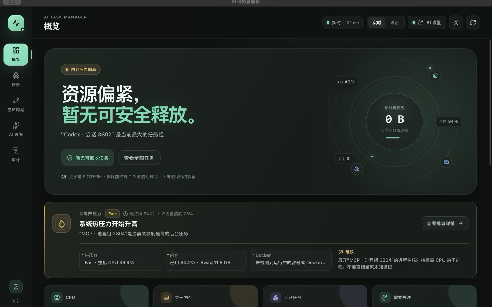
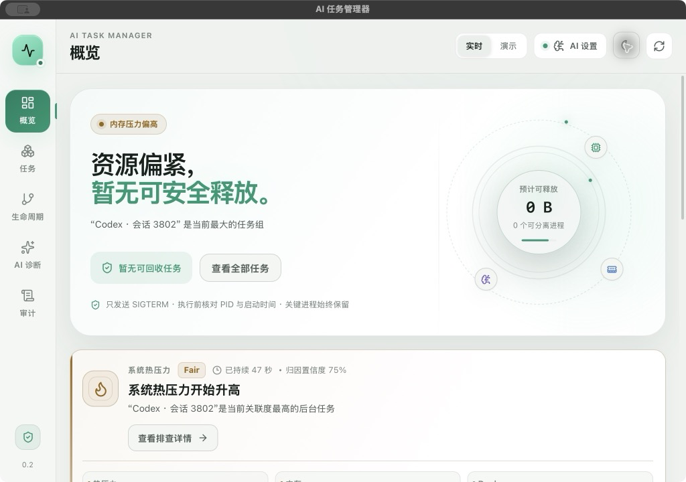

# 开发验收报告

- 验收日期：2026-11-08
- 产品版本：AI 任务管理器 `0.2.0`
- 验收范围：macOS arm64 实时系统采样、任务归因、热压力巡检、低打扰通知、显式确认后的安全回收与既有 AI 只读能力
- 结论：**macOS arm64 开发验收通过（范围内）**

> 本报告只确认下方“已验证能力”。Linux/Windows、Docker 停止、历史持久化、菜单栏/tray、自动静默清理、Developer ID 签名和 notarization 不在本次已验收范围内。

## 1. 验收环境

| 项目 | 版本/环境 |
|---|---|
| 设备架构 | macOS 15.6.1，arm64 |
| 桌面框架 | MyGo `0.7.4` |
| Go | `1.27.3` |
| Bun | `1.3.11` |
| Node.js | `v26.10.0` |
| 前端 | React `19` + TypeScript + Vite |
| 项目路径 | `/Users/alan/Documents/ChatGPT/mygo` |

## 2. 本版本验收重点

`0.2.0` 在原有“后台任务发现 → 证据归因 → 爆炸半径预览 → SIGTERM 回收”闭环上增加了系统热压力巡检：

- 使用 macOS 公开的 `NSProcessInfo.thermalState`，只展示 `nominal / fair / serious / critical` 压力等级；
- 通过 `purego` 调用 Objective-C runtime，不依赖 cgo，因此生产包与普通 Go 测试走同一条热压力读取路径；
- `serious` 连续 60 秒才通知，`critical` 立即通知，`nominal` 连续 2 分钟才结束压力事件；
- 同一归因任务 15 分钟冷却，不同归因任务可再次提示；通知权限被拒绝后停止重试；
- 通知和 AI 上下文均脱敏 PID、路径、命令行和密钥形态内容；
- 热压力解释与巡检均为只读，不生成动作令牌，也不能绕过用户确认和安全回收流程；
- 实时趋势和热压力历史只使用应用启动后的真实采样，已移除按 PID 种子生成的模拟趋势与伪事件时间。

## 3. 自动化检查

以下命令均已执行并通过：

```sh
GOTOOLCHAIN=auto go test ./... -count=1
CGO_ENABLED=0 GOTOOLCHAIN=auto go test ./... -count=1
GOTOOLCHAIN=auto go vet ./...
bun run typecheck
bun run test:web
GOTOOLCHAIN=auto bun run build
```

结果：

- 默认 Go 构建下全部包测试通过；
- `CGO_ENABLED=0` 下全部包测试通过，包括 Darwin 实时热压力读取测试；
- `go vet` 静态检查通过；
- TypeScript `tsc --noEmit` 通过；
- Vitest：**1 个测试文件，13 个测试通过**；
- MyGo 构建成功，生成 `.app` 和 `.dmg`。

热压力相关的自动化覆盖包括：

- 状态机：Fair 开始事件、Serious 60 秒阈值、Fair 重置计时、Critical 立即通知；
- 冷却与恢复：同原因 15 分钟冷却、不同原因可通知、Nominal 连续 2 分钟才结束；
- 通知安全：正文不包含 PID、用户路径、命令行或密钥，并引导用户回到应用查看证据；
- 通知运行时：有限超时、权限拒绝后不重复请求、点击通知唤起窗口、退出时停止巡检；
- 归因与证据：优先识别残留 MCP 后代，不把健康服务误判为可回收根；
- 平台真实性：不可用时不猜测温度，公开 API 为可用状态时返回合法压力等级；
- 真实清理路径：测试启动独立 `sleep 30` 子进程，经 `executeLive` 身份校验后发送 `SIGTERM`，并确认该进程实际退出；
- 确认链路：预览令牌不能直接执行；未勾选确认时前端按钮禁用；勾选后才创建独立、单次、2 分钟有效的执行令牌；
- 摘要一致性：前端核对确认摘要的目标数与 RSS 必须和预览一致，否则拒绝执行。

## 4. 构建产物

| 产物 | 路径 | 大小 |
|---|---|---|
| macOS App | `/Users/alan/Documents/ChatGPT/mygo/build/darwin-arm64/AI 任务管理器.app` | 12,508 KiB（约 12.2 MiB） |
| DMG | `/Users/alan/Documents/ChatGPT/mygo/build/darwin-arm64/ai-task-manager-0.2.0-arm64.dmg` | 4,676,096 bytes（约 4.46 MiB） |

应用 Bundle ID：`dev.aitaskmanager.desktop`。

版本字段：

```text
CFBundleShortVersionString = 0.2.0
CFBundleVersion            = 0.2.0
```

DMG SHA-256：

```text
2ee556ba41b91fb49ecb3f855cd33b0f910e5e24d8a81e195270fcd810a5d4cd
```

### 构建元数据

- 主程序经 `file` 确认为 `Mach-O 64-bit executable arm64`；
- 主程序大小：11,770,928 bytes；
- 使用 `go version -m` 确认生产构建为 **`CGO_ENABLED=0`**；
- 热压力读取在无 cgo 条件下仍返回真实公开压力等级，而不是 `unavailable`。

### 分发与签名状态

- App bundle 使用 **ad-hoc 签名**，`TeamIdentifier=not set`；
- `codesign --verify --deep --strict --verbose=2` 通过，退出码为 0；
- `spctl --assess --type execute` 拒绝该开发构建，退出码为 3；
- 未配置 Developer ID，未做 notarization；
- 本文不把该产物描述为已完成 Gatekeeper 验收的正式发行包。

## 5. 真实桌面验收

最终 `.app` 已从构建目录启动，并完成以下人工检查。

### 5.1 实时热压力卡

最终桌面复验时公开热压力接口返回 **Nominal**，更早的巡检时段也观察到 **Fair**。界面会随真实状态展示：

- 当前压力等级 `Nominal / Fair / Serious / Critical`；
- 事件持续时间、归因置信度和最多三条证据；
- 整机 CPU、内存/Swap、Docker 可用性等上下文；
- 与本轮热压力关联度最高的后台任务；
- 面向该任务的、保守的排查建议；
- 本次运行最近 12 个真实热压力样本（内部最多保留 60 个），用于判断持续或恢复趋势。

最终界面没有显示 `Unavailable`，也没有展示虚构温度或 `°C / ℃`。这说明生产包的 purego/objc 读取链路已实际工作，不只是单元测试通过。

需要强调：Fair 不等同于故障，也不直接触发 Serious 通知。该卡片用于把“机器开始变热/变慢”与可解释的后台任务证据关联起来，而不是制造告警噪音。

最终构建还实际读取到随时间变化的 CPU、内存、进程数和任务归因；一次桌面观察为 **CPU 21%、592 个进程、12.8 / 17.2 GB 统一内存、21 个 Agent 会话**，并识别到 Codex 会话、MCP 进程组和 Docker backend。上述数值仅代表该次采样，不是固定演示数据。

### 5.2 阈值、通知与点击流

已通过真实读取与自动化测试共同验证：

| 场景 | 行为 |
|---|---|
| 巡检间隔 | 主窗口就绪后每 25 秒检查一次，退出时取消 |
| Fair | 开始一次热压力事件，但不会立即通知 |
| Serious 持续 60 秒 | 生成一次低打扰通知 |
| Serious 被 Fair 打断 | 重新等待新的连续 60 秒 |
| Critical | 立即通知 |
| 回到 Nominal | 保持“恢复中”2 分钟，稳定后才结束事件 |
| 同一归因任务 | 15 分钟内不重复通知 |
| 不同归因任务 | 不受旧原因冷却阻塞 |
| 通知权限拒绝 | 记住用户选择，停止重试和系统授权弹窗打扰 |
| 点击通知 | 唤起/聚焦主窗口；窗口尚未就绪时保留待处理点击 |
| 通知发送 | 20 秒上限，避免后台任务永久挂起 |

通知正文不会携带原始 PID、用户路径、命令行或凭证，只提供脱敏后的任务语义与“打开应用查看证据”的入口。热压力事件本身不生成回收令牌。

### 5.3 演示模式：Serious → 预览 → 12 PID 回执 → Nominal

为避免在验收时终止真实后台任务，演示模式使用确定性合成快照完成完整闭环：

1. 热压力进入 **Serious**，界面展示证据并归因到旧 Codex 分支；
2. 打开回收预览，显示将停止 **12 个 MCP 后代**；
3. 明确保护 **1 个 Agent 根进程**；
4. 未勾选“我已核对影响范围”时执行按钮禁用；勾选后才允许确认；
5. 确认后生成独立执行令牌并一次性消费，12 个 PID 的演示回执全部退出，0 个失败、0 个待退出；
6. 审计流记录本次安全回收；
7. 返回概览后，热压力回落为 **Nominal**。

演示模式只更新合成快照，不向真实系统进程发送信号。实时模式执行动作时仍要求 PID 与启动时间校验、受保护根保留、仅 SIGTERM 且逐 PID 回执。

### 5.4 AI 只读与凭证边界

AI 配置为通用 OpenAI-compatible 接口，默认不联网，必须由用户主动开启远程模型并配置 Base URL、模型和 API Key。

v0.1.0 已使用 DeepSeek `deepseek-chat` 完成真实连接和问答验收；v0.2.0 未重新读取测试 Key，也未重新发起远程模型调用。既有能力通过以下回归检查：

- API Key 仅写入 macOS Keychain，不进入源码、普通配置、日志、截图或构建产物；
- 应用重启后可从 Keychain 恢复非敏感配置；
- 远程失败自动回退本地规则，不阻断核心诊断；
- 模型输出只包含事实、推断、建议与不确定项，没有可执行动作字段；
- AI 上下文不包含原始进程身份、命令行或密钥；
- AI 不能生成动作令牌，也不能停止进程。

本轮验收没有读取或打印 `/Users/alan/Desktop/tmp/key.txt`。

## 6. 视觉与响应式验收

最终 App 已重新截图并目检：





截图文件：

- `docs/assets/overview-1440x900.png`（1440×900）
- `docs/assets/overview-1024x720.png`（1024×720）
- `docs/assets/overview-light-1024x720.png`（1024×720）
- `docs/assets/ai-settings-1440x900.png`（1440×900）
- `docs/assets/ai-diagnostics-1440x900.png`（1440×900）

检查结果：

- 主视觉采用石墨/薄荷配色与高留白布局，亮暗主题均无粉色；
- 信息层级优先回答“是否可释放”“关联到什么任务”“风险边界是什么”，而不是堆叠基础指标；
- 实时状态、任务归因、证据、置信度和建议在同一张热压力卡内形成因果链；
- 1440×900 与 1024×720 均无横向页面溢出；
- 主内容区可独立滚动；1024 宽度下 AI 页面切换为单列；
- 关键风险同时使用文字、图标和颜色表达，不只依赖颜色；
- `prefers-reduced-motion: reduce` 下动画时长降为 `0.01ms`，信息与操作仍完整。

最终演示 GIF：

- 路径：`docs/assets/demo-flow.gif`
- 尺寸：1200×750
- 帧率：12 fps
- 时长：12.66 秒
- 大小：4,251,991 bytes
- 流程：概览 → 任务 → 生命周期 → AI 诊断 → 爆炸半径预览 → AI 设置

GIF 使用确定性演示 fixture；录制过程没有连接真实进程，也没有执行真实回收。

## 7. 已验证的安全边界

- 任务预览只包含具备回收证据的后代进程；
- Agent 会话根、IDE、Shell、系统进程、本应用及祖先、监听中的开发任务和容器受保护；
- 预览只读；用户必须在完整目标/保护列表下显式勾选确认；
- 确认后才创建独立执行令牌，实时动作前再次校验 PID 与启动时间；
- 预览和执行令牌均在 2 分钟后过期且单次消费；
- 只发送 SIGTERM，不自动升级为 SIGKILL；
- 逐 PID 记录成功、待退出和失败；
- 审计记录只保留在当前应用会话中；
- Windows 终止路径明确返回拒绝；
- Docker 当前只读取容器列表，不执行停止；
- 热压力采用公开 API，不使用 SMC、root、私有 IOKit 或 `powermetrics`，不根据 CPU 负载反推温度。

## 8. 未验收事项

以下事项没有在本次验收中完成，不能对外声称可用：

- Docker 容器停止/清理；
- Linux 和 Windows 运行时热压力；
- SQLite 持久化历史、趋势图与审计重启恢复；
- 菜单栏/tray、开机启动和自动静默清理；
- GitHub Actions 多平台构建、Developer ID 签名与 notarization；
- Playwright 视觉回归；
- 正式 60fps/P95 帧时间/CLS 性能门禁；
- 完整键盘流、200% 缩放和大字体专项验收。

## 9. 验收结论

**AI 任务管理器 `0.2.0` macOS arm64 开发验收通过。**

通过的核心闭环是：

```text
系统热压力 / CPU / 内存 / 任务快照
→ 证据归因与置信度
→ 热压力卡展示原因和建议
→ Serious 持续 60 秒后低打扰通知
→ 用户从通知进入应用
→ 爆炸半径预览
→ 显式勾选确认
→ 独立单次令牌
→ SIGTERM 安全回收
→ 逐 PID 回执与审计流
→ 热压力恢复确认
```

本次通过不等同于正式公开发行。正式发布前仍需解决 Developer ID 签名、notarization、跨平台构建与运行时验收，以及正式性能回归。
